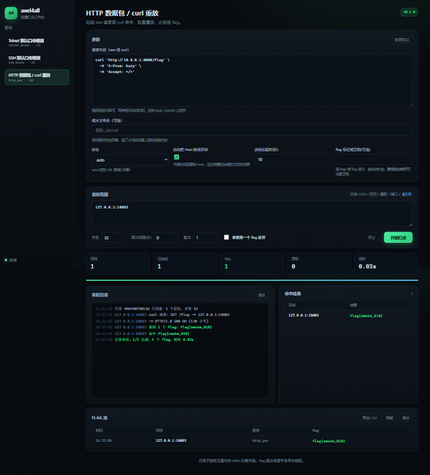

# awd4all

AWD 比赛用的批量打点工作台。单机运行，本地 Web UI，插件化扩展。



## 它解决什么

AWD 场上真正重复劳动的不是“写 exp”，是写完之后那一堆复制粘贴：把 IP 一个个改进去、等结果、从响应里抠 flag、记哪家出了、回头忘了谁打过。这个工具把这些收进一个界面里，exp / POC 仍然是你现场自己写的，工具只负责调度。

## 已内置的三个打法

| 插件 | 说明 |
| --- | --- |
| `telnet_brute` | 读账号字典，对目标批量试 telnet 登录，登录后跑命令取 flag |
| `ssh_brute` | 同上，SSH 版（paramiko） |
| `http_poc` | 粘贴 raw 请求或 curl 命令，自动识别格式，把 Host 换成目标后批量重放，正则抠 flag |

## 安装与启动

```bash
pip install -e .
python -m awd4all            # 默认 127.0.0.1:8737，自动开浏览器
python -m awd4all --port 9000 --no-browser
```

只监听本机回环，不给局域网开。数据落在当前目录的 `data/awd4all.db`。

## 目标范围怎么写

一个输入框，下面这些随便混着填，逗号、空格、换行都行：

```
10.0.0.1                    单个
10.0.0.0/24                 CIDR
10.0.0.1-10.0.0.50          完整区间
10.0.0.1-50                 末段区间
10.0.0.*                    通配（末段 1-254）
10.0.0.1:22                 带端口
10.0.0.0/24:8080            CIDR 带端口
@targets.txt                从文件读，文件里可继续混用以上写法
```

没写端口时用插件自己的默认端口（telnet 23 / ssh 22 / http 80）。

## POC 怎么给

`http_poc` 的请求框直接粘贴，raw 和 curl 两种格式自动识别，不需要先存成文件（也可以填文件路径，二选一）。

Burp 里右键复制出来的 raw：

```
POST /api/login HTTP/1.1
Host: 127.0.0.1
Content-Type: application/json
Cookie: sid=xxx

{"user":"admin"}
```

从终端复制出来的 curl：

```bash
curl -X POST 'http://127.0.0.1:8080/api/login' \
  -H 'Content-Type: application/json' \
  -d '{"user":"admin"}'
```

`-X / -H / -d / -b / -u / -A / -G` 这些常用参数都会转成对应的请求，续行符（`\` 或 `^`）也能处理。
发包前 `Host` 会自动换成目标 IP:端口；需要指定虚拟主机的，把“自动把 Host 换成目标”关掉，或者直接在请求里写 `Host: 域名`。
占位符 `{{ip}}` / `{{port}}` / `{{team}}` 两种格式里都能用。

## 参数

- 并发：同时打多少个目标
- 每次间隔：两个任务发起之间的停顿，用来压一下频率
- 重试：单个目标连接/执行失败后重跑几次，比赛网络抖的时候有用
- 拿到第一个 flag 就停：`stop_on_hit`
- 中途停止：跑起来之后右边会出现停止按钮，已经发出的请求不会打断，剩下的不再发起
- flag 池支持导出 CSV，赛后复盘直接丢表格里

## 自定义插件

在运行目录下建 `plugins/`，丢一个 `.py` 进去，重启即可，主程序不用动：

```python
from awd4all.plugins.base import Finding, Param, Plugin, find_flags
from awd4all.targets import Target


class MyExploit(Plugin):
    name = "my_exploit"
    title = "我的自定义打法"
    description = "想干什么写在这"
    default_port = 8080
    params = [
        Param("path", "请求路径", "text", "/api/flag"),
        Param("flag_regex", "flag 正则(可选)", "text", ""),
    ]

    def run(self, target: Target, params: dict, emit):
        import urllib.request

        url = f"http://{target.host}:{target.port or self.default_port}{params['path']}"
        emit("info", f"打 {url}")
        body = urllib.request.urlopen(url, timeout=5).read().decode("utf-8", "replace")
        regexes = [params["flag_regex"]] if params.get("flag_regex") else []
        flags = find_flags(body, regexes)
        if not flags:
            return None
        return [Finding(target=target.label, plugin=self.name, flag=flags[0], evidence=body[:800])]
```

`emit(level, message)` 直接进界面日志，level 用 `info / ok / warn / error / debug`。
返回值是 `Finding` 列表，`flag` 留空表示“打成功了但没 flag”（比如登录成功）。

## flag 标记怎么写

参数里的 “flag 标记或正则” 不用写完整正则。填 `flag{`、`flag`、`CTF{` 这种前缀就行，
工具会补成 `前缀{...}` 的匹配；写 `flag{.*}` 这种半正则也认，会按前缀处理，不会贪婪匹配到行尾。

要精确控制（限定字符集、固定长度、大小写）再写完整正则，比如 `flag\{[a-z0-9]{8}\}`，此时原样使用。

## flag 怎么办

工具只负责收集、去重、落库，**不内置任何平台提交接口**。各平台接口不统一，内置等于给开源项目挖坑。

flag 池里点一下就能复制。要自动提交，自己写个脚本读 `data/awd4all.db` 的 `flags` 表发给平台即可，也可以按平台的适配代码提 PR，仓库只收通用接口实现。

## 开发

```bash
python -m unittest discover -s tests -v
```

## 协议与作者

MIT License，作者 guaidao2 & coolmoon。

## 免责声明

仅用于授权范围内的 AWD 比赛环境及自有靶机。用之前先确认你对目标有授权，flag 提交遵守比赛平台规则。
